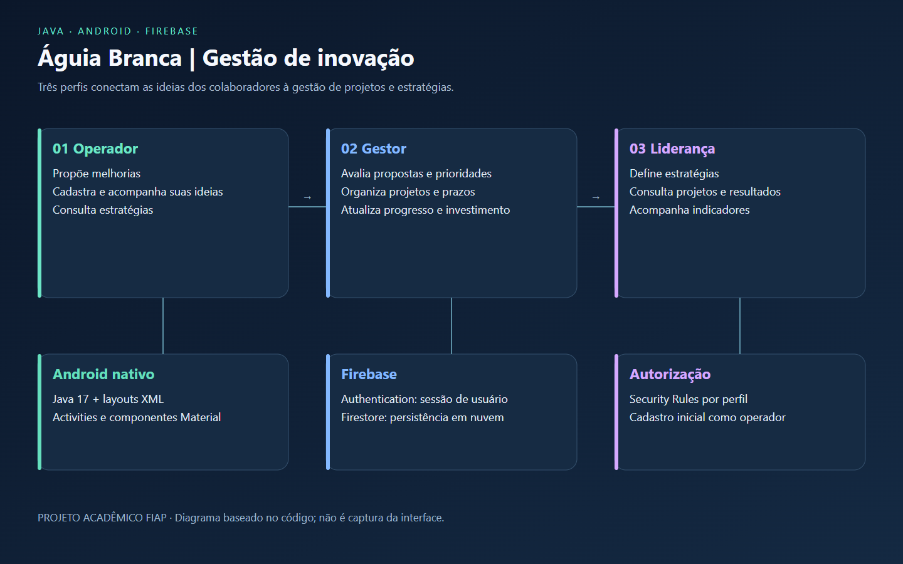

# Águia Branca · Gestão de inovação

Aplicativo Android para transformar ideias de colaboradores em projetos acompanhados pela gestão. Operadores registram propostas, gestores avaliam e organizam projetos, e a liderança acompanha indicadores e estratégias.

**Projeto acadêmico · Android nativo · Java + Firebase**



O diagrama apresenta os perfis e as tecnologias do código. Não é uma captura do aplicativo nem uma comprovação de operação em produção.

## Tecnologias e responsabilidades

| Tecnologia | Aplicação |
|---|---|
| Java 17 | Activities, validações, adaptação de listas e cálculos do dashboard |
| Android / XML / Material Components | Telas nativas e navegação |
| Firebase Authentication | Login por e-mail e senha |
| Cloud Firestore | Usuários, ideias, projetos e estratégias |
| Firestore Security Rules | Restrições por perfil e propriedade dos registros |
| Gradle 8.9 / Android Gradle Plugin 8.7.3 | Compilação e testes |

O Gradle usa Kotlin DSL; o código do aplicativo fornecido está em Java.

## Fluxos implementados

- **Operador:** cadastro de ideias e consulta de suas propostas e estratégias.
- **Gestor:** avaliação de ideias, prioridade, cadastro e progresso de projetos.
- **Liderança:** cadastro de estratégias, consulta de projetos e dashboard com indicadores.

Novas contas recebem perfil `operador`. Os perfis `gestor` e `lider` são atribuídos por administração confiável no Firebase, sem permitir a autoatribuição pelo cadastro.

## Executar no Android Studio

1. Instale o Android Studio, um JDK 17 e o Android SDK 35.
2. Abra esta pasta como projeto Android.
3. Crie um projeto Firebase próprio, cadastre o pacote `com.nordhub.aguiachallenge` e habilite Authentication por e-mail/senha e Cloud Firestore.
4. Baixe seu `google-services.json` e coloque-o em `app/`. Esse arquivo fica fora do Git. O arquivo `google-services.example.json` contém apenas valores fictícios para compilar, sem autenticação funcional.
5. Publique as regras deste repositório no seu projeto Firebase. Consulte [configuração e perfis](docs/configuracao.md).
6. Execute o app em um dispositivo ou emulador com Android 7.0 ou superior.

Para apenas conferir a compilação, copie `app/google-services.example.json` para `app/google-services.json` e execute no PowerShell:

```powershell
.\gradlew.bat assembleDebug testDebugUnitTest
```

## Testar as regras localmente

Com Node.js 22 e Java 21 ou superior disponíveis no PATH:

```powershell
npm.cmd ci
npm.cmd run test:rules
```

O comando usa `demo-aguia-portfolio`, um projeto local de demonstração, sem acessar o Firebase de produção. Os testes cobrem acesso anônimo, autoelevação de perfil, leitura de ideias de outro usuário, aprovação e restrições de projetos e estratégias.

## Organização

- `app/src/main/java`: Activities, models e adapters.
- `app/src/main/res/layout`: interfaces XML.
- `firestore.rules`: autorização no banco.
- `tests`: testes de autorização no emulador Firestore.
- `docs/proposta-academica.pdf`: documentação da entrega original.

## Estado e validação

Compilação debug, teste unitário Android original e oito testes de autorização Firestore executados com sucesso. O teste unitário original é básico e não valida os fluxos completos de UI. A operação ponta a ponta com um projeto Firebase configurado pelo leitor deve ser validada no dispositivo. A integração com Firebase não depende da configuração original do autor, que não é distribuída.

## Contexto e autoria

Trabalho acadêmico FIAP, publicado no portfólio de Ericles Santos. A documentação de entrega preserva o contexto original e os créditos que acompanham o material. As marcas citadas identificam o desafio acadêmico; este repositório não é um produto oficial das empresas.

[Detalhes da validação](docs/validacao.md).
